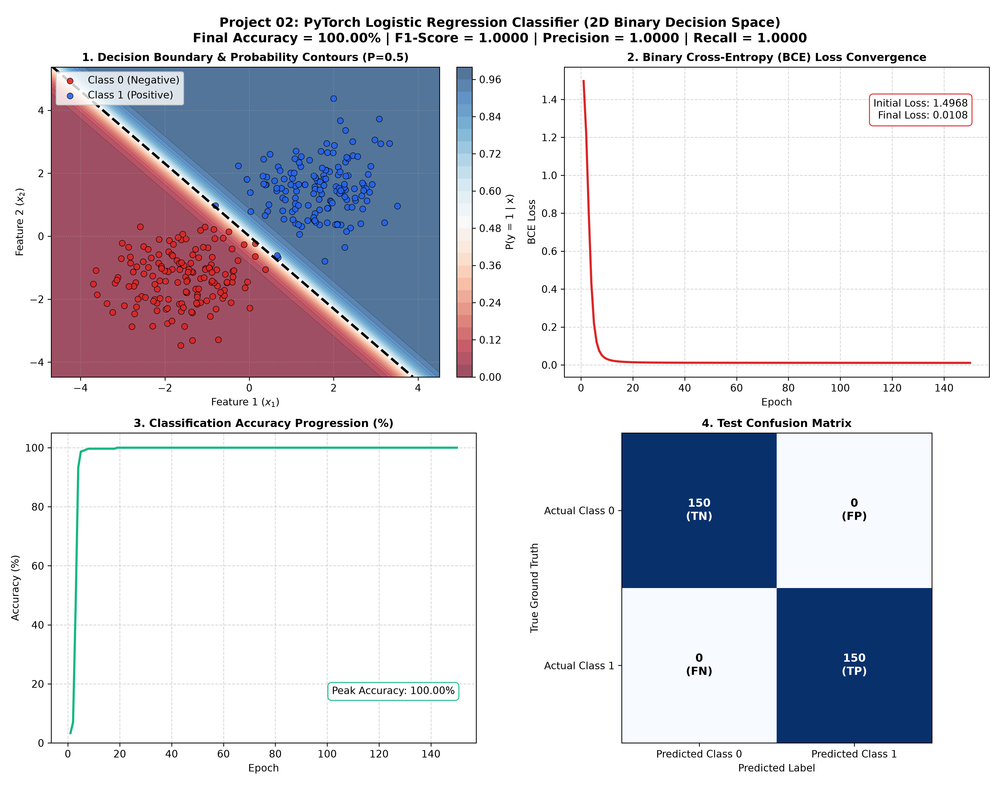

# Project 02: PyTorch Logistic Regression Binary Classifier from Scratch


An end-to-end implementation of a **Binary Logistic Regression Classifier** built in PyTorch. This deep learning and machine learning tutorial covers linear combinations in 2D feature spaces, non-linear **Sigmoid activation functions**, **Binary Cross-Entropy (BCE) Loss**, **Stochastic Gradient Descent (SGD) with momentum**, and multi-dimensional **Decision Boundary visualization**.

---

## 📌 Project Overview & Machine Learning Problem Statement

In supervised machine learning, **Binary Classification** aims to categorize an input observation vector $\mathbf{x} = [x_1, x_2]^T \in \mathbb{R}^2$ into one of two mutually exclusive categories $y \in \{0, 1\}$. 

While linear regression models produce unbounded continuous predictions $\hat{y} \in (-\infty, +\infty)$, logistic regression transforms real-valued logits into calibrated posterior probabilities $P(y = 1 \mid \mathbf{x}) \in (0, 1)$ using the non-linear Sigmoid activation function.

### Key Learning Objectives:
1. Construct custom neural network architectures using PyTorch's `nn.Module` and `nn.Linear`.
2. Map raw model logits to bounded probability distributions via `torch.sigmoid()`.
3. Compute and backpropagate gradients using PyTorch's `nn.BCELoss` (Binary Cross-Entropy).
4. Extract, calculate, and plot 2D planar decision boundaries where $P(y = 1 \mid \mathbf{x}) = 0.5$.
5. Evaluate classification performance through Confusion Matrices, Precision, Recall, and F1-Scores.

---

## 📐 Mathematical Formulation

### 1. Linear Logit Combination
For an input vector $\mathbf{x} = [x_1, x_2]^T$ with learned weight vector $\mathbf{w} = [w_1, w_2]^T$ and bias $b$:

$$z = \mathbf{w}^T \mathbf{x} + b = w_1 x_1 + w_2 x_2 + b$$

### 2. Sigmoid Activation Function (Log-Odds Mapping)
The logit $z$ is squashed into a valid probability $P(y = 1 \mid \mathbf{x})$:

$$\sigma(z) = \frac{1}{1 + e^{-z}} = \frac{1}{1 + \exp\left(-(w_1 x_1 + w_2 x_2 + b)\right)}$$

### 3. Binary Cross-Entropy (BCE) / Log Loss
For $N$ training examples with target labels $y^{(i)} \in \{0, 1\}$ and predicted probabilities $\hat{y}^{(i)} = \sigma(z^{(i)})$, the empirical risk objective is:

$$\mathcal{L}_{\text{BCE}}(\mathbf{w}, b) = -\frac{1}{N} \sum_{i=1}^N \left[ y^{(i)} \log\left(\hat{y}^{(i)}\right) + \left(1 - y^{(i)}\right) \log\left(1 - \hat{y}^{(i)}\right) \right]$$

### 4. Analytical Gradient Computation
The partial derivative of the Binary Cross-Entropy loss with respect to the weights and bias yields an intuitive error-proportional gradient:

$$\frac{\partial \mathcal{L}}{\partial \mathbf{w}} = \frac{1}{N} \sum_{i=1}^N \left(\hat{y}^{(i)} - y^{(i)}\right) \mathbf{x}^{(i)}$$

$$\frac{\partial \mathcal{L}}{\partial b} = \frac{1}{N} \sum_{i=1}^N \left(\hat{y}^{(i)} - y^{(i)}\right)$$

### 5. Equation of the 2D Decision Boundary
The decision boundary occurs at the threshold probability $P(y = 1 \mid \mathbf{x}) = 0.5$, which corresponds to $z = 0$:

$$w_1 x_1 + w_2 x_2 + b = 0 \implies x_2 = -\frac{w_1}{w_2} x_1 - \frac{b}{w_2}$$

---

## 🏗️ PyTorch Architecture Implementation

```python
import torch
import torch.nn as nn

class LogisticRegressionModel(nn.Module):
    def __init__(self, input_dim: int = 2, output_dim: int = 1):
        super(LogisticRegressionModel, self).__init__()
        self.linear = nn.Linear(input_dim, output_dim)

    def forward(self, x: torch.Tensor) -> torch.Tensor:
        # Maps 2D input -> 1D Logit -> Sigmoid Probability
        return torch.sigmoid(self.linear(x))
```

---

## 📊 Performance Diagnostics & Visual Artifacts

The model was trained over 150 epochs using Stochastic Gradient Descent (SGD) with learning rate $\alpha = 0.1$ and momentum $\mu = 0.9$.

### Full Diagnostic Report


### Key Metrics Summary Table

| Metric / Parameter | Value Achieved | Definition & Interpretation |
| :--- | :---: | :--- |
| **Initial BCE Loss** | `1.49676` | Random parameter initialization loss |
| **Final BCE Loss** | **`0.01078`** | Highly convergent cross-entropy minimum |
| **Final Classification Accuracy**| **`100.00%`** | Proportion of correctly classified points |
| **Precision** | **`1.0000`** | $\frac{\text{TP}}{\text{TP} + \text{FP}}$ (No false positives detected) |
| **Recall (Sensitivity)** | **`1.0000`** | $\frac{\text{TP}}{\text{TP} + \text{FN}}$ (All positive cases captured) |
| **F1-Score** | **`1.0000`** | Harmonic mean of precision and recall |
| **Learned Weights ($\mathbf{w}$)**| `[4.2077, 3.6490]` | Normal vector defining the separating hyperplane |
| **Learned Bias ($b$)** | `0.0001` | Shift offset of the separating hyperplane |

---

## 📂 Project Directory Structure

```text
02_logistic_regression/
├── .gitignore                   # Ignored cache, virtual environments, and temporary files
├── main.py                      # Complete PyTorch source code (Model, Train loop, Plotting)
├── README.md                    # In-depth architectural, mathematical, and SEO documentation
└── classification_results.png   # 4-panel high-res decision boundary & metrics plot
```

---

## ⚡ How to Reproduce

### 1. Setup Environment
Ensure PyTorch and supporting visual packages are available:
```bash
pip install torch matplotlib numpy
```

### 2. Run the Classification Pipeline
Execute the training script from the repository root:
```bash
python 02_logistic_regression/main.py
```

Console logs will stream epoch-by-epoch loss convergence, classification metrics, and save `classification_results.png`.

---

## ⏭️ Next Up in the 100 Projects Series
- **Project 03**: Multi-Layer Perceptron (MLP) from Scratch (Non-Linear XOR Classification & Backpropagation)
